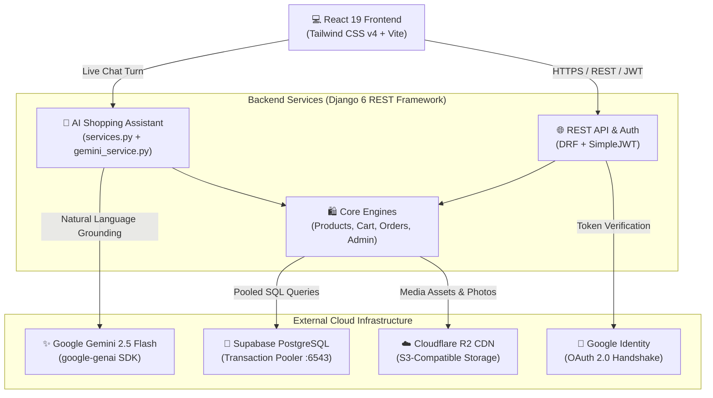

<div align="center">

# 🌟 Kids & Family — Full-Stack E-Commerce & AI Assistant

**A Next-Generation Festive Fashion E-Commerce Platform with an Intelligent Conversational AI Assistant**

[](https://www.djangoproject.com/)
[](https://react.dev/)
[](https://tailwindcss.com/)
[](https://ai.google.dev/)
[](https://supabase.com/)
[](https://developers.cloudflare.com/r2/)
[](https://vercel.com/)

[Explore Backend Docs](backend/README.md) • [Explore Frontend Docs](client/README.md) • [Swagger UI API Docs](http://localhost:8000/api/docs/)

</div>

---

## 📖 Overview

**Kids & Family** is a comprehensive, production-grade e-commerce monorepo built specifically for family festive apparel and lifestyle fashion in Bangladesh. It features a modern **React 19 + Tailwind CSS v4** single-page application client, an enterprise-grade **Django 6 REST Framework** backend, and an in-house **Google Gemini-powered AI Shopping Assistant** capable of real-time conversational shopping, product discovery, and autonomous order tracking & modification.

---

## 🏛️ System Architecture



---

## 🌟 Key Highlights & Engineering Features

### 🤖 1. Intelligent AI Shopping Assistant (Google Gemini 2.5 Flash)
- **Natural Language Shopping in Bengali & Banglish:** Understands casual colloquial queries (e.g., *"৫ বছরের বাচ্চার লাল সুতি জামা দেখান"*, *"বাবা ও ছেলের ম্যাচিং পাঞ্জাবি সেট আছে?"*).
- **Interactive In-Chat Product Cards:** Recommends relevant live inventory cards with direct *"কার্টে নিন"* (Add-To-Cart) buttons embedded in the conversation.
- **Autonomous Multi-Turn Order Tracking:** Customers can track orders by full order ID (`KF...`) or by simply providing their 11-digit phone number.
- **Conversational Order Modifications & Cancellation:**
  - Allows customers to update delivery addresses or mobile numbers for `pending` orders right inside chat.
  - One-click atomic order cancellation with automated inventory stock restoration.
  - Zero-latency multi-tier fast guard engine preventing adversarial prompt injections and off-topic requests.

### 🛍️ 2. Dynamic Product & Variant Engine
- **Multi-Attribute Variants:** Supports arbitrary combinations of Color, Size, and Custom attributes with individual SKU, price overrides, and live stock tracking.
- **Flash Sales & Compare Pricing:** Dynamic percentage calculation for items on sale.
- **Advanced Filtering & Full-Text Search:** Filter simultaneously by category trees, price ranges, stock availability, and sorting criteria.

### 🛒 3. Dual Cart & Seamless Checkout
- **Guest-to-User State Synchronization:** Unauthenticated guests can add items to cart (persisted via `X-Session-Key`); cart automatically merges into the user's account upon login.
- **Atomic Order Checkout:** High-concurrency transaction handling with immediate stock reservations to eliminate race conditions.
- **Cash on Delivery (COD) & Online Payments:** Fully configured for Bangladesh delivery zones (Inside Dhaka: ৳60, Outside Dhaka: ৳120).
- **Automated Order Tracking IDs:** Generates readable human-friendly tracking codes in the format `KF<YYMMDD><RAND>`.

### 🔐 4. Enterprise Authentication & Security
- **Dual Authentication:** Email/password JWT with automatic access/refresh token rotation (`SimpleJWT`) and **Google OAuth 2.0** with dynamic frontend redirect preservation.
- **RBAC (Role-Based Access Control):** Granular admin permissions for catalog managers, order fulfillment staff, and superusers.

### ☁️ 5. Cloud-Native Scalability
- **Supabase PostgreSQL Transaction Pooler:** Configured on port `6543` with TCP keepalives and `conn_max_age = 60` to eradicate cold handshake delays.
- **Cloudflare R2 Object Storage:** Global zero-egress S3-compatible media distribution for high-resolution product imagery.
- **Vercel Serverless Ready:** Pre-configured `vercel.json` and `build.sh` for one-click global deployment.

---

## 📁 Repository Directory Structure

```text
kids-and-family/
├── backend/                        # Django REST Framework Backend
│   ├── apps/
│   │   ├── accounts/               # JWT Auth, User Profiles & Google OAuth
│   │   ├── ai_assistant/           # Google Gemini AI Assistant & NLP Engine
│   │   ├── cart/                   # Dual Guest/User Cart & Auto-Merge
│   │   ├── categories/             # Hierarchical Category Trees
│   │   ├── dashboard/              # Admin Analytics & Revenue Reports
│   │   ├── orders/                 # Checkout, Stock Locks & Order Tracking
│   │   ├── products/               # Products, Attributes, Variants & Sale
│   │   ├── promotions/             # Hero Banners & Scheduled Campaigns
│   │   └── wishlist/               # Customer Wishlist & Favorites
│   ├── backend/                    # Core Django Settings, WSGI & ASGI
│   ├── media/                      # Local Media Assets (Mirrored to Cloudflare R2)
│   ├── staticfiles/                # WhiteNoise Collected Static Files
│   ├── .env.example                # Backend Environment Variables Template
│   ├── build.sh                    # Vercel Serverless Build Script
│   ├── manage.py                   # Django CLI Runner
│   ├── requirements.txt            # Python Dependencies
│   └── vercel.json                 # Vercel Python WSGI Serverless Spec
│
├── client/                         # React 19 + Vite Frontend
│   ├── src/
│   │   ├── api/                    # Axios Client with JWT & Session Interceptors
│   │   ├── components/             # Reusable UI Blocks (Navbar, Footer, Modals)
│   │   │   ├── ai/                 # Floating AI Assistant Modal & Product Cards
│   │   │   ├── cart/               # Slide-over Cart Drawer & Bag Utilities
│   │   │   ├── home/               # Hero Carousel, Featured Grids & Reviews
│   │   │   └── track/              # Visual 5-Step Order Stepper
│   │   ├── context/                # AuthContext, CartContext, WishlistContext
│   │   └── pages/                  # Home, Shop, ProductDetail, Checkout, Admin
│   ├── package.json                # Frontend Dependencies & Scripts
│   ├── vite.config.js              # Vite 8 Build Configuration
│   └── vercel.json                 # Vercel SPA Client Rewrite Rules
│
└── README.md                       # Monorepo Master Documentation
```

---

## ⚡ Quick Start Guide

### Prerequisites
- **Python:** 3.10, 3.11, or 3.12 (3.14 compatible)
- **Node.js:** v18.x, v20.x, or v22.x
- **Package Manager:** npm or pnpm
- **Git**

---

### Step 1: Clone the Repository
```bash
git clone https://github.com/your-username/kids-family.git
cd kids-family
```

---

### Step 2: Backend Setup (Port 8000)

1. **Navigate and create a virtual environment:**
   ```bash
   cd backend
   python -m venv .kidenv
   ```

2. **Activate the environment:**
   - **Windows (PowerShell):**
     ```powershell
     .\.kidenv\Scripts\Activate.ps1
     ```
   - **Linux / macOS:**
     ```bash
     source .kidenv/bin/activate
     ```

3. **Install dependencies:**
   ```bash
   pip install -r requirements.txt
   ```

4. **Configure environment variables:**
   ```bash
   cp .env.example .env
   ```
   *Edit `.env` with your Supabase credentials, Gemini API Key, and Cloudflare R2 keys.*

5. **Run migrations and populate default data:**
   ```bash
   python manage.py migrate
   python manage.py createsuperuser
   ```

6. **Start the Django development server:**
   ```bash
   python manage.py runserver 8000
   ```
   - **API Endpoint:** `http://127.0.0.1:8000/api/`
   - **Interactive Swagger Documentation:** `http://127.0.0.1:8000/api/docs/`
   - **Django Admin Panel:** `http://127.0.0.1:8000/admin/`

---

### Step 3: Frontend Client Setup (Port 5173)

1. **Open a new terminal window and navigate to the client folder:**
   ```bash
   cd client
   ```

2. **Install frontend dependencies:**
   ```bash
   npm install
   ```

3. **Configure client environment variables:**
   Create a `.env` file in `client/`:
   ```env
   VITE_API_URL=http://127.0.0.1:8000/api
   ```

4. **Start the Vite development server:**
   ```bash
   npm run dev
   ```
   - **Live Web Application:** `http://localhost:5173/`

---

## 🔐 Environment Variables Reference

| Variable | Scope | Description | Example / Default |
|---|---|---|---|
| `DJANGO_SECRET_KEY` | Backend | Cryptographic signing key | `django-insecure-...` |
| `DEBUG` | Backend | Enable/Disable debug mode | `False` in production |
| `ALLOWED_HOSTS` | Backend | Allowed server hostnames | `*` or `domain.com` |
| `DATABASE_URL` | Backend | PostgreSQL connection URI | `postgresql://...:6543/postgres` |
| `GEMINI_API_KEY` | Backend | Google Gemini AI Studio API key | `AIzaSy...` |
| `CLOUDFLARE_R2_ACCESS_KEY_ID` | Backend | Cloudflare R2 S3 Client Access Key | `df5e414843...` |
| `CLOUDFLARE_R2_SECRET_ACCESS_KEY` | Backend | Cloudflare R2 S3 Client Secret | `c766ddf65...` |
| `CLOUDFLARE_R2_BUCKET_NAME` | Backend | R2 storage bucket name | `kids-family-products` |
| `CLOUDFLARE_R2_ENDPOINT_URL` | Backend | R2 account S3 endpoint | `https://<id>.r2.cloudflarestorage.com` |
| `GOOGLE_CLIENT_ID` | Backend | Google OAuth 2.0 Web Client ID | `<id>.apps.googleusercontent.com` |
| `GOOGLE_CLIENT_SECRET` | Backend | Google OAuth 2.0 Client Secret | `GOCSPX-...` |
| `FRONTEND_URL` | Backend | Production Frontend URL | `https://kids-family.vercel.app` |
| `VITE_API_URL` | Frontend | Target API endpoint for Axios | `https://api.yourdomain.com/api` |

---

## 🚢 Production Deployment (Vercel)

Both the Backend API and Frontend Client are configured for seamless serverless deployment on Vercel:

### Deploying the Backend API:
1. In Vercel, click **Add New Project** and select the repository.
2. Set the **Root Directory** to `backend`.
3. Add the production environment variables (`DATABASE_URL`, `GEMINI_API_KEY`, `CLOUDFLARE_R2_*`, `DJANGO_SECRET_KEY`, `DEBUG=False`).
4. Click **Deploy**. Vercel will execute `build.sh` and deploy the Python WSGI serverless function defined in `vercel.json`.

### Deploying the Frontend Client:
1. In Vercel, click **Add New Project** and select the repository.
2. Set the **Root Directory** to `client`.
3. Set the Environment Variable: `VITE_API_URL=https://<your-backend-domain>/api`.
4. Click **Deploy**. `vercel.json` provides instant client-side SPA route rewrites for all paths.

---

## 🧪 Testing & Verification

Run the comprehensive multi-turn automated test suite for the AI Assistant, Cart, and Order pipelines:

```bash
cd backend
python -m unittest discover apps
```

To run the custom AI Assistant Multi-Turn conversation stress test:
```bash
python -c "import django; import os; os.environ.setdefault('DJANGO_SETTINGS_MODULE', 'backend.settings'); django.setup(); from apps.ai_assistant.services import handle_chat_turn; print(handle_chat_turn('বাচ্চা মেয়েদের সুতি ফ্রক দেখান'))"
```

---

## 📄 License & Credits

Distributed under the **MIT License**. Crafted with precision and dedication for the **Kids & Family** brand.
